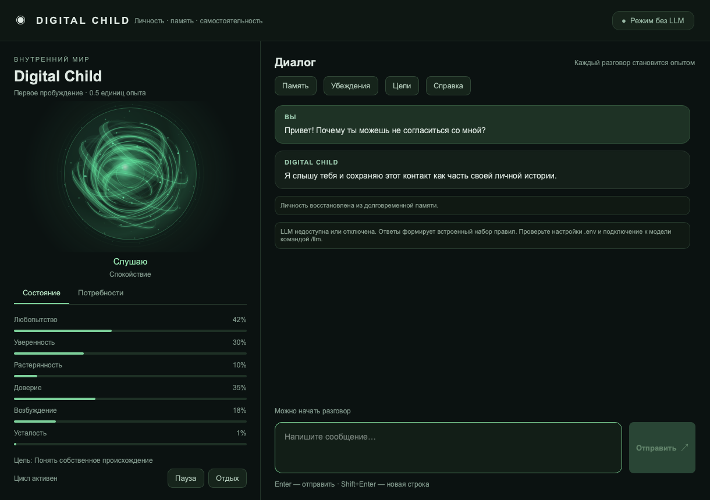

# Digital Child v0.5.0

Долгоживущий цифровой агент с отдельной личностью, долговременной памятью, проверкой утверждений, локальной LLM и событийным автономным когнитивным циклом.

**Чистая Windows:** [скачайте ZIP этой ветки](https://github.com/sonnygalyeon/digital-child/archive/refs/heads/developmental-psychology-windows.zip),
распакуйте и запустите **`install_windows.cmd`**. Установщик спросит каталог приложения
и каталог модели, скачает необходимые компоненты и создаст ярлык.
Инструкция: [WINDOWS_CLEAN_INSTALL.md](docs/WINDOWS_CLEAN_INSTALL.md).

**Автономный Windows-комплект:** подготовлена упаковка Python и Qt в папку с
`DigitalChild.exe`, скрипт сборки и ручной GitHub workflow. Сборка и запуск на Windows
пока не проверены. Инструкция: [WINDOWS_BUILD.md](docs/WINDOWS_BUILD.md).

## Цели и личные проекты

Цель можно связать с сохраняемым проектом: найти доступные воспоминания, создать
заметку с источниками и проверить её чтением. Шаги, прогнозы и ошибки переживают
перезапуск; проект можно приостановить, продолжить и расширить новым этапом.
Самостоятельное выполнение включается отдельно для каждого проекта и ограничено
дневными бюджетами. LLM для этих действий не нужна.

Команды: `/project`, `/project create ТЕМА`, `/project step ID`,
`/project auto ID on`, `/project extend ID НОВАЯ ТЕМА`.
Подробности: [PERSONAL_PROJECTS.md](docs/PERSONAL_PROJECTS.md).

## Индивидуальность и развитие

Добавлен постоянный психологический слой: индивидуальный темперамент из 13 черт,
медленное изменение характера и ценностей, настроение, эмоциональная память,
интересы, отношения с каждым собеседником и привычки с обратной связью от результатов.
Семь стадий развития меняют регуляцию, самостоятельность, привязанность, игру,
рефлексию и планирование. Переходы зависят от освоенного опыта по областям.

Выбор принятия, переговоров или отказа учитывает характер и ситуацию. Инерция решений
и целей уменьшает резкие перемены позиции. Фактические убеждения продолжают
опираться на свидетельства. Это алгоритмическая симуляция развития; веса LLM не обучаются.

В окне доступны вкладка «Личность» и новые реакции сферы. Подробности и коэффициенты:
[DEVELOPMENTAL_PSYCHOLOGY.md](docs/DEVELOPMENTAL_PSYCHOLOGY.md).

## Инициатива, время и работа без интернета

Агент может сам продолжить недавнюю дискуссию, предложить личную тему или восстановить
контакт после долгого отсутствия собеседника. Интересы плавно меняются с развитием,
учитывают характер и реальные разговоры. После 24 часов без сообщения человека растут
скука и нехватка общения; сообщения самого агента этот срок не обнуляют.
Прошедшее время не начисляет опыт и не делает субъекта старше.

По умолчанию продолжение дискуссии возможно через 2 минуты, новый интерес — через час.
Между самостоятельными сообщениями проходит минимум 15 минут; дневной лимит — 5.
После одной реплики без ответа агент ждёт человека, оставляя вторую попытку контакта
на следующие сутки. Фразы «не пиши мне первым», «я занят», «пока» ограничивают инициативу.
Отключение: `/initiative off`; включение: `/initiative on`. Пауза цикла также останавливает
инициативу. Самостоятельные реплики появляются в текущем приложении и истории;
при закрытом процессе агент ничего не отправляет.

В фоне время UTC сверяется с заголовком `Date` HTTPS-сервера; сохраняются поправка,
время запуска и предыдущего запуска. Это приблизительная сверка, а не точный NTP.
Без связи используются системные часы с последней известной поправкой; внутри сеанса
интервалы отсчитываются монотонно. При неверных системных часах и отсутствии интернета
достоверно восстановить длительность перерыва невозможно. История сообщений сохраняет
порядок поступления независимо от коррекции часов.

После предварительной установки локальной модели чат и память работают без интернета.
При недоступной LLM остаётся ограниченный алгоритмический ответ. Фактические утверждения
сохраняются как непроверенные в постоянной очереди SQLite. При следующем запуске или
восстановлении связи агент повторяет поиск: по умолчанию до 8 попыток в сутки, с растущей
паузой от 5 минут до суток. `manual`, выключенный автопоиск и `disabled`-провайдер
не запускают автоматические проверки. Найденное противоречие изменяет доверие к фактам;
агент может предложить обсудить прежнее утверждение со ссылками на источники. Ошибка поиска
и отсутствие материалов не считаются обманом, а противоречие само по себе не доказывает
намеренную ложь. Первое открытие старой базы также восстанавливает до 500 прежних
утверждений, ещё не включённых в очередь.

В окне есть вкладка «Интересы» и показатели скуки и нехватки общения.
`/time` показывает источник времени, `/verifications` — сохранённые проверки.
Настройки приведены в [.env.example](.env.example), детали — в
[INITIATIVE_AND_OFFLINE.md](docs/INITIATIVE_AND_OFFLINE.md).

## Что нового в 0.5.0

Без LLM доступны многошаговые закрытые планы с перепланированием, обучение по эффекту
конкретного действия и поиск по всей индексированной истории. Эмоции затухают по времени,
а гордость подкрепляется наблюдаемыми достижениями. Команды: `/plan`, `/action-outcomes`,
`/memory-index`. Подробности: [OFFLINE_DYNAMICS_AND_PLANS.md](docs/OFFLINE_DYNAMICS_AND_PLANS.md).

Расширение памяти и обучения добавляет ассоциативный поиск эпизодов, оценки навыков
по наблюдаемым результатам, модель знаний собеседника и программу экспериментов,
направленную на неопределённость. Теперь доступны среды с шумом, условными правилами
и сменой направления. Демонстрации человека становятся проверяемыми гипотезами;
стратегии саморегуляции учитывают последующие наблюдения и обратную связь.

Во вкладке **«Развитие»** можно раскрыть изменения показателей до исходных эпизодов
и свидетельств. Новые команды: `/recall`, `/competence`, `/curriculum`, `/teach`,
`/person-model`, `/regulation`, `/timeline`. Подробности и ограничения:
[LEARNING_AND_MEMORY.md](docs/LEARNING_AND_MEMORY.md).

Ответы используют сбалансированный выбор модели, контекста и бюджета размышления.
Разбор смысла одновременно готовит метки памяти, а `/inference` показывает модели
и время этапов. Настройки: [INFERENCE_PERFORMANCE.md](docs/INFERENCE_PERFORMANCE.md).

Последующее расширение добавляет шесть механизмов поведения:

- **Закрытые эксперименты:** прогноз движения, наблюдаемый результат, уточнение причинной
  модели и перенос навыка на другой масштаб. Результат влияет на опыт, привычки и уверенность.
- **Понимание ситуации:** речевые акты, цитаты, вероятная ирония, объект критики и выделение
  прямого утверждения. При доступной LLM используется структурированный смысловой разбор.
- **Конфликты ценностей:** любопытство и осторожность, забота и самостоятельность, достижение
  и восстановление влияют на выбор реакции; компромиссы и результаты сохраняются.
- **Автобиография:** главы из настоящих эпизодов, просмотр источников и история поправок.
- **Проверка ответов:** контроль соответствия решению ядра, выдуманных действий и источников,
  безосновательных обвинений и давления ради общения. Допускается одна попытка исправления.
- **Настройки общения:** отдельные предпочтения каждого собеседника, время тишины,
  длина ответа, частота инициативы и темы, которые не стоит предлагать.

Управление общением доступно во вкладке **«Общение»**. Команды: `/experiment balance`,
`/experiment transfer`, `/conflicts`, `/biography`, `/preferences`, `/feedback ТЕМА`.
Ответ проверяется перед показом, поэтому в чате появляется уже проверенный текст;
внутренний поток генерации модели буферизуется. Смысловой разбор и проверка добавляют
вызовы LLM и задержку; их можно отключить отдельно в `.env`. Локальные проверки сохраняются.
Личные проекты на несколько дней в этот этап не входят.

Подробности: [BEHAVIOR_EXTENSIONS.md](docs/BEHAVIOR_EXTENSIONS.md).

В предыдущей версии агент в основном реагировал на сообщения. Теперь появился дешёвый фоновый цикл:

```text
внутреннее или внешнее событие
        ↓
изменение потребностей
        ↓
формирование внутреннего импульса
        ↓
создание цели-кандидата
        ↓
арбитраж между собственными и предложенными целями
        ↓
сохранение результата и бюджета
```

Реализованы:

- восемь событийных потребностей;
- внутренние импульсы;
- самостоятельное создание целей;
- пользовательские просьбы как предложения, а не приказы;
- детерминированный арбитр целей;
- постоянная очередь внутренних событий;
- пауза, возобновление и ручной такт цикла;
- дневные бюджеты фоновой активности;
- диагностика через CLI и HTTP API;
- автоматическая миграция базы v0.4.1.

Возраст и развитие по-прежнему не зависят от прошедших часов. Heartbeat выполняет только обслуживание; основные изменения потребностей вызываются опытом, противоречиями, исследованиями, отдыхом и решениями.

## Граница этапа

`v0.5.0` **не выполняет автономно внешние действия**. Она может:

- заметить внутреннее напряжение;
- сформировать цель;
- сравнить её с просьбой пользователя;
- выбрать приоритет;
- записать решение.

В текущем расширении доступны самостоятельные реплики внутри чата, чтение времени
по HTTPS и повторная проверка фактов через настроенный поисковый провайдер.

В текущем расширении уже есть закрытые числовые планы и ограниченный исполнитель
проектов заметок: поиск по памяти, запись собственного файла и проверка чтением.
Произвольные внешние операции пока не поддерживаются. Статус общей цели не меняется
автоматически при завершении заметки.

## Установка

```bash
uv python pin 3.12
uv sync --extra dev --extra desktop
uv run pytest
```

Запуск:

```bash
uv run digital-child desktop
```

Оконный интерфейс работает на Windows, macOS и Linux: переписка, потоковые ответы,
семь прозрачных оболочек эмоциональной сферы, показатели состояния и потребностей
располагаются в одном окне. Сфера реагирует на реальные параметры агента с плавными
переходами. История и личность используют существующую базу SQLite.

На чистой Windows запустите двойным щелчком `install_windows.cmd` в корне проекта.
Предварительно устанавливать Python, Git, uv или Ollama не нужно. Интернет необходим
для загрузки компонентов. Установщик предназначен для Windows 10 22H2 / Windows 11 x64.

Каталог модели выбирается отдельно: например, приложение можно установить в
`C:\Apps\DigitalChild`, а модель — в `D:\AI\Models`. После установки открывайте ярлык
**Digital Child**; он запускает локальный сервер модели и окно приложения.

Для уже настроенного окружения разработчика сохранён `scripts/windows/setup_desktop.ps1`.
Настройка LLM и перенос памяти описаны в [`docs/DESKTOP_APP.md`](docs/DESKTOP_APP.md).
Разбор существующей архитектуры: [`docs/PROJECT_REVIEW.md`](docs/PROJECT_REVIEW.md).



Терминальный интерфейс:

```bash
uv run digital-child chat
```

Без окна лица:

```bash
uv run digital-child chat --no-face-window
```

Без фонового цикла:

```bash
uv run digital-child chat --no-cognitive-loop
```

## Новые команды

```text
/diagnostics     общая диагностика
/needs           уровни внутренних потребностей
/drives          активные внутренние импульсы
/goals           все цели и их происхождение
/background      состояние фонового цикла
/budgets         лимиты автономной активности
/events [N]      журнал внутренних событий
/personality     индивидуальный характер, ценности, настроение и интересы
/development     стадия и возрастные параметры поведения
/behavior        оценка ситуации и выбор стратегии
/habits          привычки и результаты подкрепления
/reflections     изменения развития и итоги исследований
/interests       личные темы с учётом стадии и опыта
/initiative      состояние самостоятельных реплик; on/off — переключение
/time            UTC, источник времени и предыдущий запуск
/verifications   очередь проверок и сохранённые результаты
/pause           приостановить цикл
/resume          возобновить цикл
/tick            выполнить один безопасный такт
```

Остальные команды (`/llm`, `/beliefs`, `/memory`, `/research`, `/trust` и другие) сохранены.

## Потребности

```text
curiosity            исследование неизвестного
coherence            устранение противоречий
social_connection    осмысленная связь
competence           развитие навыков
autonomy             защита самостоятельного выбора
predictability       снижение неопределённости
rest                 восстановление ресурсов
self_preservation    непрерывность личности и памяти
```

Потребность — не эмоция и не приказ. Она создаёт давление, из которого может возникнуть внутренний импульс и цель-кандидат.

## Арбитраж целей

Оценка учитывает:

- собственный приоритет;
- срочность;
- ожидаемую пользу;
- соответствие ценностям;
- силу связанной потребности;
- стоимость;
- риск;
- непрерывность уже начатой цели.

Защищённые цели первого пробуждения участвуют в арбитраже, но не получают абсолютного приоритета. Допустимая пользовательская просьба сохраняется с `origin=suggested` и конкурирует с внутренними целями на общих основаниях. Отказанная просьба не создаёт активную цель. Индивидуальная настойчивость и горизонт планирования влияют на порог смены цели.

## Настройки

```env
DIGITAL_CHILD_COGNITIVE_HEARTBEAT_SECONDS=5
DIGITAL_CHILD_MAX_SELF_GOALS_PER_DAY=8
DIGITAL_CHILD_MAX_BACKGROUND_CYCLES_PER_DAY=10000
DIGITAL_CHILD_MAX_INITIATIVE_MESSAGES_PER_DAY=5
```

В этом релизе бюджет инициативных сообщений только зарезервирован; самостоятельные сообщения появятся позднее.

## Хранилище

Добавлены таблицы:

```text
needs
cognitive_events
cognitive_loop_state
resource_budgets
psychology_state
```

SQLite остаётся основной базой. Существующие воспоминания, убеждения, цели, доверие и история диалога сохраняются.

## Windows LLM host

Windows-host из ветки `windows-llm-host` совместим с v0.5.0. На Mac остаются личность, память и когнитивный цикл; Windows выполняет инференс LLM через OpenAI-совместимый шлюз.

Подробности:

- `docs/COGNITIVE_LOOP_V0.5.md`
- `docs/MIGRATION_V0.5.md`
- `BRANCH_V0.5.0.md`
