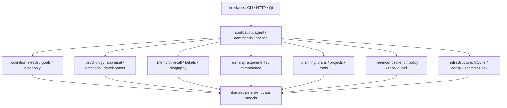

# Архитектура Digital Child

## Организация кода

Проект использует модульную архитектуру с отдельными интерфейсами,
прикладной координацией, предметными подсистемами и инфраструктурой.
Основное приложение — пакет `src/digital_child`. Необязательный
`windows_host` имеет своё окружение и API и остаётся отдельным приложением.



Диаграмма показывает основные направления координации. Предметные подсистемы
также используют SQLiteRepository и общие сервисы инфраструктуры. Границы
подпакетов отражают ответственность; интерфейс репозитория пока представлен
конкретным SQLiteRepository. Единственная реализация SQL остаётся в нём.

| Пакет | Ответственность | Основные модули |
| --- | --- | --- |
| `domain` | Схемы данных без ввода/вывода | `models`, `personality`, `constitution`, `text` |
| `application` | Сценарии и жизненный цикл | `agent`, `service`, `commands`, `actions`, фоновые runtime |
| `cognition` | Цели, потребности и решения | `cognitive_loop`, `goal_arbiter`, `autonomy`, `initiative` |
| `psychology` | Оценка ситуации и состояние личности | `engine`, `emotions`, `behavior`, `development` |
| `memory` | Поиск и осмысление опыта | `associative_memory`, `beliefs`, `epistemics`, `autobiography` |
| `learning` | Изменение оценок по наблюдениям | `experiments`, `competence`, `regulation` |
| `planning` | Сохраняемые планы и их действия | `action_plans`, `projects`, `tools` |
| `inference` | Работа с языковой моделью | `backend`, `policy`, `types`, `prompting`, `reply_guard` |
| `infrastructure` | Хранение и внешние сервисы | `repository`, `config`, `search`, `timekeeping`, `app_paths`, `budgets` |
| `interfaces` | Адаптеры ввода и отображения | `cli`, `http/api`, `desktop/*`, `terminal/*` |

## Проверяемые правила зависимостей

`python scripts/dev/check_architecture.py` разбирает AST исходников,
не импортирует приложение и не запускает фоновые процессы. Он проверяет:

1. Все локальные импортируемые модули существуют.
2. `domain` импортирует только свои модули, стандартную библиотеку и Pydantic.
3. Предметные подсистемы и инфраструктура не импортируют `application` или `interfaces`.
4. `application` не импортирует интерфейсы.
5. Qt, FastAPI, Uvicorn и Prompt Toolkit используются только в `interfaces`.
6. Внутренние импорты используют канонические пути, а не фасады совместимости.
7. Между модулями нет циклов импортов; ссылки внутри `TYPE_CHECKING` учитываются
   при проверке границ, но исключаются из графа исполняемых импортов.

Подпакеты имеют лёгкие `__init__.py`, без запуска сервисов и массовых реэкспортов.
Явные импортируемые фасады в корне оставлены для основных публичных путей и
установленных entry points; они не содержат самостоятельной бизнес-логики.

## Прикладные сценарии

`application.service.create_agent` создаёт репозиторий, backend модели и поисковый
провайдер. `DigitalChildAgent` связывает состояние, психологию, память и цикл.
Он остаётся основным публичным объектом приложения.

`application.commands.ChatCommandRouter` обрабатывает общие команды. Его используют
CLI и процесс Qt-ядра, поэтому команды не принадлежат терминальному интерфейсу.

`application.actions.ActionService` содержит выполнение экспериментов, числовых
планов и личных проектов. Он получает владельца-агента с текущим состоянием и
блокировкой; прежние методы агента явно делегируют вызовы этому сервису.
Так сохраняются публичный API и существующие границы транзакций.

`application.initiative_runtime` планирует работу в простое и самостоятельные
реплики. `verification_runtime` восстанавливает постоянную очередь проверок.
Обновления состояния сериализуются блокировкой агента; длительные вызовы модели
и поиск выполняются по существующим правилам отмены и фоновых задач.

## Поток ответа

```text
интерфейс → команды / interact → намерение и автономия
  → психология, доверие, эмоции → память и контекст
  → выбор модели и бюджета → генерация → проверка ответа → интерфейс
```

Результат ядра и свидетельства сохраняются независимо от модели. Внутренний поток
генерации буферизуется до проверки ответа. Общение с человеком не означает
автоматического исполнения любого предложения.

## Данные и транзакции

`infrastructure.repository.SQLiteRepository` обслуживает одну SQLite-базу и
предоставляет вложенные транзакции на savepoint. Эпизоды, личность, цели, события,
feature records и индексы используют ту же границу фиксации. Реорганизация кода
не меняет схему базы или JSON-формат сохранённых моделей.

Личные проекты сохраняют аргументы шага до файловой операции. Запись в файл и
SQLite восстанавливаются явным протоколом повторов и сверки содержимого;
общей транзакции файловой системы и SQLite нет. Описание:
[личные проекты](features/PERSONAL_PROJECTS.md).

## Интерфейсы и процессы

- CLI и HTTP создают приложение через `application.service`.
- Qt отображает данные в главном процессе; ядро работает в spawned-процессе.
- Дочерний процесс использует общий обработчик команд, не импортируя CLI.
- Эмоциональная сфера и терминальное отображение находятся в `interfaces`.
- Точка входа Windows вызывает `freeze_support` до Qt и сохраняет настройки,
  память и журналы отдельно от каталога комплекта.

Окно не выполняет SQL и вызовы LLM напрямую. Механизм `spawn`, публичные команды
и внешние HTTP-маршруты сохраняются.

## Файлы проекта

- `docs/guides/` — установка, запуск и настройка.
- `docs/features/` — устройство отдельных механизмов.
- `docs/history/` — прежние этапы и миграции, явно помеченные как исторические.
- `scripts/dev/` — статическая проверка архитектуры и обслуживание кэшей.
- `scripts/windows/` — установка, запуск и сборка Windows.
- `scripts/macos/` — подготовка локальной модели на macOS; прежний shell-путь
  сохранён коротким перенаправляющим скриптом.
- `tests/` — существующие проверки по областям приложения; миграции вынесены отдельно.
- `packaging/` — файлы упаковки, без пользовательских настроек или памяти.
- `.cache/` — воспроизводимые кэши Ruff, mypy и pytest.
- `data/` — локальная память и заметки; `.venv/` — установленное окружение.

`workspace.py clean` удаляет только кэши и не удаляет окружения, данные или модели.
При этой реорганизации выполняются статические проверки, без тестов, LLM и
проверки готового Windows-комплекта. Контроль импортов не заменяет проверку
поведения интерфейсов, восстановления процессов и сериализации на целевой ОС.
